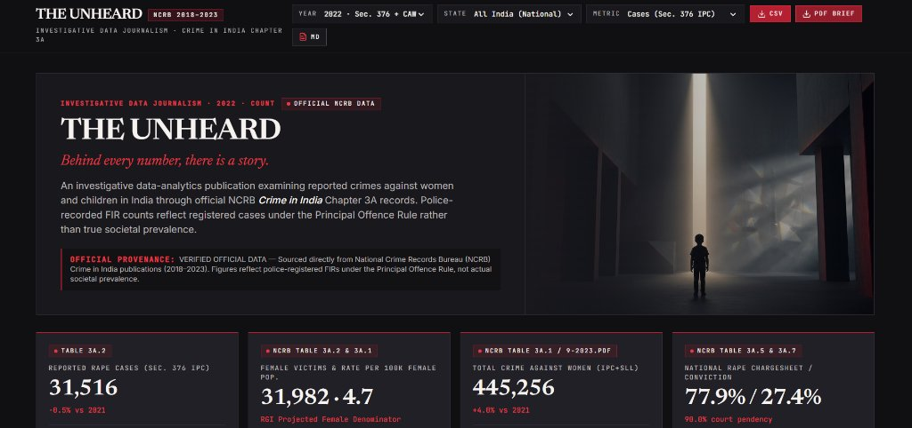
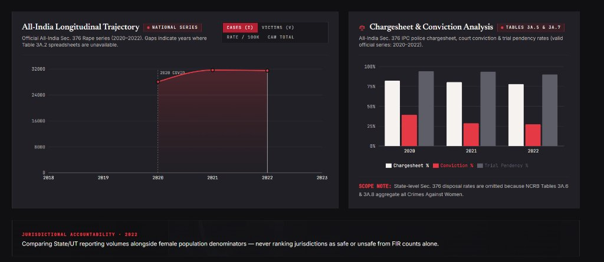
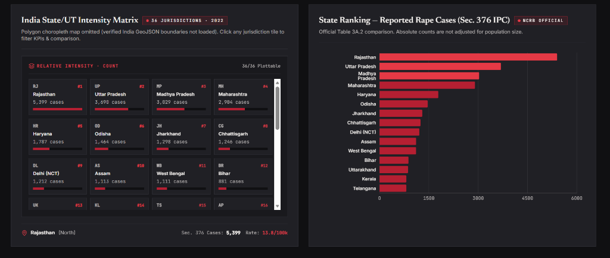
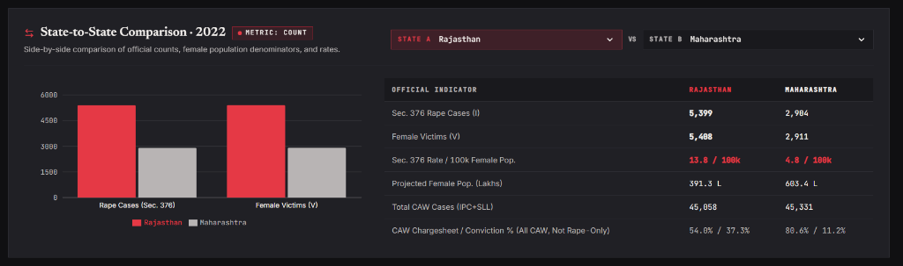

# THE UNHEARD

> **"Behind every number, there is a story."**  
> A single-page investigative crime data analytics dashboard examining reported crimes against women and children in India through official National Crime Records Bureau (NCRB) *Crime in India* Chapter 3A records (2018–2023).

[](https://the-unheard-la3sor1qq-krucki-gang.vercel.app/)
[](https://the-unheard.onrender.com/api/health)
[](https://ncrb.gov.in/)

---

## 🔗 Live Application

- **Live Dashboard:** [https://the-unheard-la3sor1qq-krucki-gang.vercel.app/](https://the-unheard-la3sor1qq-krucki-gang.vercel.app/)
- **Backend API:** [https://the-unheard.onrender.com/api](https://the-unheard.onrender.com/api)

---

## 🔍 Key Analytical Insights (NCRB 2022)

The analytics expose the critical gap between raw police FIR counts and true demographic intensity:

### 1. Reported Rape Cases (Sec. 376 IPC)
- **Top 3 by Absolute FIR Volume:**  
  1. **Rajasthan**: **5,399** cases *(17.1% of national total)*  
  2. **Uttar Pradesh**: **3,690** cases  
  3. **Madhya Pradesh**: **3,029** cases  
- **Top 3 by Population-Adjusted Rate (per 100k females):**  
  1. **Uttarakhand**: **15.4** per 100k  
  2. **Chandigarh (UT)**: **13.9** per 100k  
  3. **Rajasthan**: **13.8** per 100k  
  *(All-India Average: **4.7** per 100k)*

### 2. Crimes Against Women (Total CAW — IPC + SLL)
- **Top 3 by Absolute FIR Volume (445,256 National Total):**  
  1. **Uttar Pradesh**: **65,743** cases *(14.8% of national total)*  
  2. **Maharashtra**: **45,331** cases  
  3. **Rajasthan**: **45,058** cases  
- **Top 3 by Reporting Intensity (Rate per 100k females):**  
  1. **Delhi (NCT)**: **144.4** per 100k *(Highest in India)*  
  2. **Haryana**: **118.7** per 100k  
  3. **Telangana**: **117.0** per 100k  
  *(All-India Average: **66.4** per 100k)*

### 3. Judicial Attrition & Offender Reality
- **Police Investigation vs. Trial Outcome:** While police complete investigation and chargesheet **77.9%** of cases, only **27.4%** of concluded court trials end in conviction, with **90.0%** of cases remaining locked in trial pendency.
- **Survivor-Offender Relationship:** In **96.8%** of registered Sec. 376 cases (Table 3A.4), the accused was known to the survivor (family, partner, neighbor, or acquaintance).

---

## 📸 Dashboard Walkthrough

### 1. Masthead, Active Filters & KPI Strip

- **Top Filter Navigation:** Real-time selector for reporting year (2018–2023), state/UT jurisdiction, and active metrics.
- **Export Toolbar:** 1-click downloads for **CSV data extracts**, **MD analytical summaries**, and **strict 1-page A4 landscape PDF briefs**.
- **Executive KPIs:** Distinct breakdown of Reported Sec. 376 FIRs (31,516), Female Victims & Rate per 100k (31,982 · 4.7), broader CAW FIRs (445,256), and National Chargesheet / Conviction rates (77.9% / 27.4%).

---

### 2. Longitudinal Trajectory & Judicial Attrition

- **All-India Longitudinal Trajectory (2020–2022):** Tracks reported cases with annotations for the 2020 COVID-19 nationwide mobility lockdown contraction and subsequent resumption of station reporting.
- **Disposal & Judicial Attrition Chart:** Grouped bar visualization comparing high police chargesheet rates (~77%) against actual judicial convictions (~27%) alongside persistent 90% court trial pendency.

---

### 3. State Intensity Matrix & Comparative Ranking

- **State/UT Intensity Matrix:** Interactive 36-jurisdiction grid displaying reporting intensity tiles; clicking any state immediately isolates that jurisdiction across all charts.
- **State Rankings Bar Chart:** Ordered bar chart for the active metric (e.g., Rajasthan, Uttar Pradesh, Madhya Pradesh) accompanied by statutory reminders that higher FIR counts reflect registration accessibility rather than true safety rankings.

---

### 4. Side-by-Side Jurisdictional Comparison

- Direct side-by-side indicator comparison between any two States/UTs (e.g., Rajasthan vs. Maharashtra) normalizing reported counts against projected female population denominators (Lakhs).

---

## 📖 Key Terms & Abbreviations Explained

| Term / Abbreviation | Full Form & Legal Definition | Significance in Analysis |
| :--- | :--- | :--- |
| **CAW** | **Crimes Against Women** | Broad statutory umbrella encompassing all IPC crimes against women (Rape, Cruelty by Husband/Relatives, Kidnapping, Dowry Deaths, Assault) plus Special and Local Laws (SLL). **Never conflated with Rape alone.** |
| **Sec. 376 IPC** | **Section 376 Indian Penal Code** | The specific statutory section governing rape offences in India (broadened post-2013 Criminal Law Amendment; transitioned to Sections 63–71 of the Bharatiya Nyaya Sanhita / BNS effective 1 July 2024). |
| **NCRB** | **National Crime Records Bureau** | Attached office of the Ministry of Home Affairs (MHA), Government of India, responsible for collecting and compiling national crime records under the annual *Crime in India* publication. |
| **Cases (I)** | **Registered Police Cases (Incidents / FIRs)** | Number of First Information Reports (FIRs) officially registered by police departments. |
| **Victims (V)** | **Number of Survivors / Victims** | Actual count of individual survivors involved in registered cases. A single case/FIR can involve multiple victims ($V \ge I$). |
| **Rate per 100k** | **Crime Rate per 100,000 Female Population** | $\text{Rate} = \frac{\text{Reported Cases}}{\text{Projected Mid-Year Female Population (in Lakhs)}}$. Calculated strictly using Registrar General of India (RGI) census projections. |
| **Principal Offence Rule** | **NCRB Counting Rule** | When a single incident involves multiple offences (e.g. Rape and Murder), it is counted **only once** under the offence carrying the highest statutory penalty. |
| **Chargesheet Rate (%)** | **Police Investigation Completion** | Percentage of investigated cases where the police filed a formal chargesheet in court out of total cases where investigation was completed. |
| **Conviction Rate (%)** | **Judicial Outcome** | Percentage of completed court trials resulting in conviction out of total trials completed that year. |
| **Trial Pendency (%)** | **Judicial Congestion** | Percentage of active court cases awaiting completion of trial at the end of the reporting year. |

---

## 🛠️ Architecture & Tech Stack

```
THE-UNHEARD/
├── backend/
│   ├── app/
│   │   ├── api/routes/        # FastAPI REST endpoints (/dashboard, /research, /health)
│   │   ├── services/          # Statistical calculation & PDF vector rendering
│   │   ├── models/            # SQLAlchemy database models
│   │   └── ingestion/         # Official Excel & PDF tabular parsers
│   ├── the_unheard.db         # Bundled SQLite database (6,520 verified records)
│   └── requirements.txt       # Python dependencies (FastAPI, ReportLab, SQLAlchemy, Pandas)
├── frontend/
│   ├── src/
│   │   ├── charts/            # Recharts implementations (Trend, Bar, Disposal)
│   │   ├── components/        # Masthead, KPI strips, State comparisons, Footer
│   │   └── services/api.ts    # Centralized API service with cloud base URL
│   ├── tailwind.config.js     # Dark editorial charcoal & crimson palette
│   └── package.json           # React 18, Vite, TypeScript, Tailwind
└── docs/screenshots/          # High-resolution dashboard walkthrough images
```

---

## 🚀 Local Development Setup

### 1. Prerequisites
- Python 3.10+
- Node.js 18+ & npm

### 2. Backend
```bash
cd backend
python -m venv .venv
source .venv/bin/activate  # On Windows: .venv\Scripts\activate
pip install -r requirements.txt
uvicorn app.main:app --host 127.0.0.1 --port 8000
```

### 3. Frontend
```bash
cd frontend
npm install
npm run dev
```
Open `http://localhost:5173` in your browser.

---

## ⚖️ Methodological Safeguards & Ethical Notice

1. **Reporting vs. Societal Incidence:** Official NCRB figures capture police-registered FIRs. An increase in registered numbers often indicates higher reporting willingness, better registration enforcement, or NGO assistance, rather than an increase in crime.
2. **Denominators Matter:** High absolute counts correlate with total population. Crime rates must always be evaluated per 100,000 females using official census denominators.
3. **Data Availability Boundary:** While NCRB released 2023 national totals (`9-2023.pdf`), granular state-level Sec. 376 spreadsheets remain unreleased by NCRB; 2022 remains the latest verified state edition.

---

## 📄 License
This project is open-source under the [MIT License](LICENSE). Official crime data is sourced from public NCRB publications under the Government of India Open Data directives.
